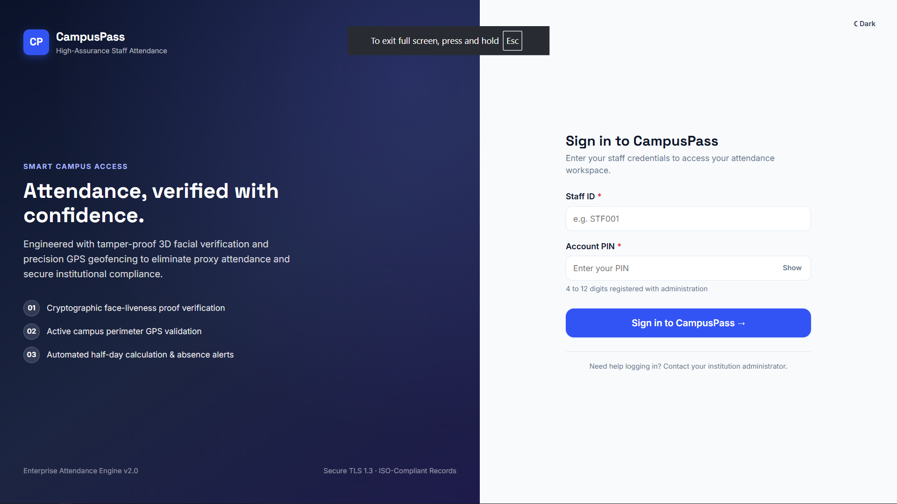
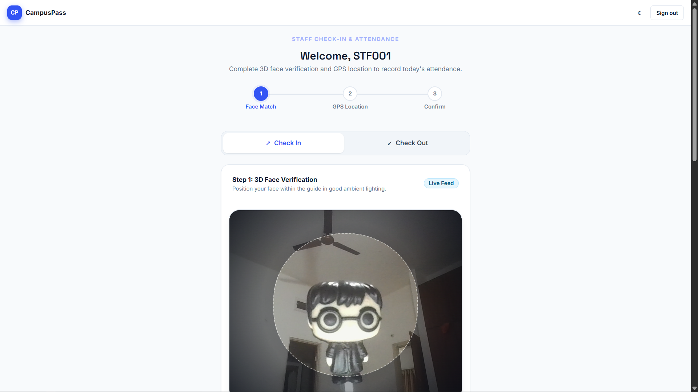
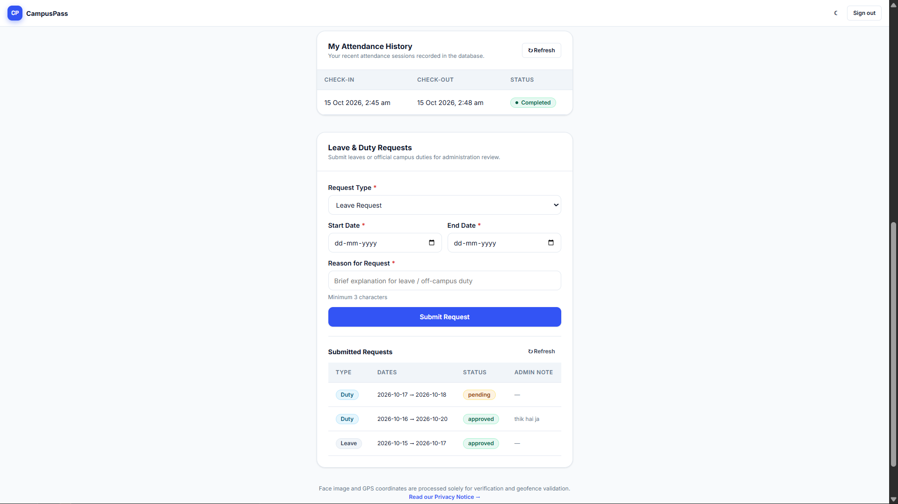
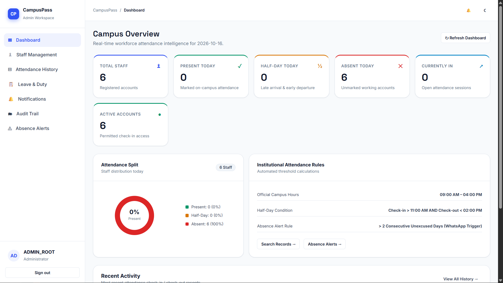
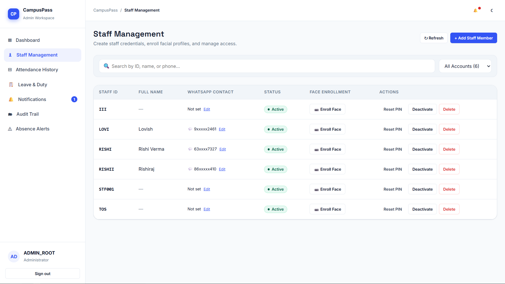
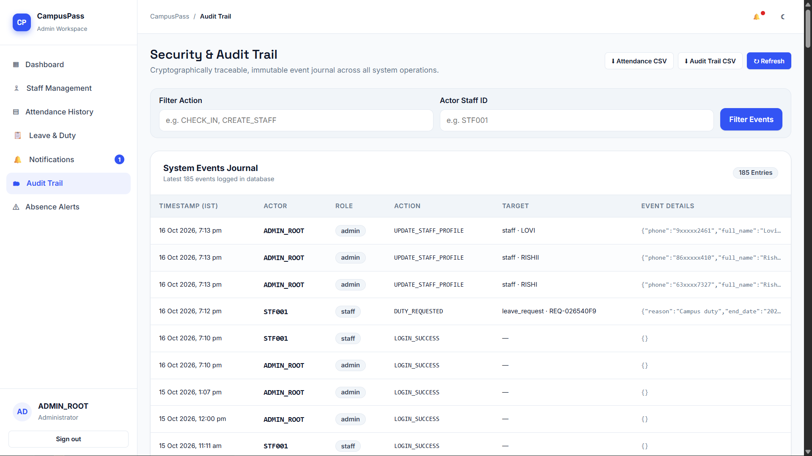
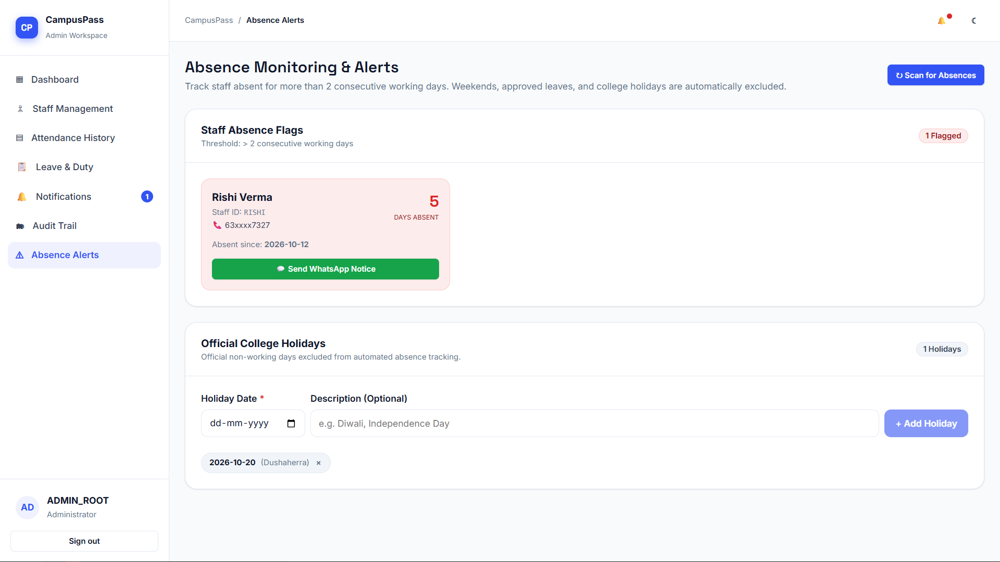
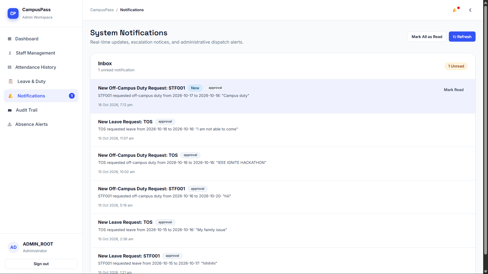

<div align="center">

# 🎓 CampusPass

### Smart Campus Attendance System

**Skip the gate. Not the verification.**

A mobile-friendly staff attendance system combining PIN authentication, face verification, and GPS-based campus geofencing to make attendance more convenient.

<p>
  <a href="https://campuspass-ignite.vercel.app/"><strong>🌐 Live Demo</strong></a>
  &nbsp; • &nbsp;
  <a href="https://github.com/xyresiiic/CampusPass-IGNITE"><strong>💻 Source Code</strong></a>
  &nbsp; • &nbsp;
  <a href="https://github.com/xyresiiic/CampusPass-IGNITE/issues"><strong>🐛 Report an Issue</strong></a>
</p>

[](https://react.dev/)
[](https://www.typescriptlang.org/)
[](https://fastapi.tiangolo.com/)
[](https://supabase.com/)
[](https://vercel.com/)
[](https://render.com/)

</div>

---

## ✨ About the Project

**CampusPass** is a smart staff attendance management system developed for the **SKIT College Hackathon**. Traditional attendance processes at campus gates can create queues and delays during busy arrival hours. CampusPass explores a more convenient approach by letting staff complete attendance verification using a phone or supported browser.

Staff sign in with their staff ID and PIN, use the device camera for face verification, and provide a location reading that the backend checks against the configured campus geofence. Authorized administrators can manage staff accounts, enroll face profiles, and review attendance records through a dedicated dashboard.

The project combines a responsive web interface, a FastAPI backend, and a Supabase-hosted PostgreSQL database.

> **Project goal:** Make staff attendance more convenient without treating a simple login or GPS reading as sufficient verification on its own.

## 🖼️ Application Screenshots

Explore the CampusPass interface below. These images are loaded directly from the repository's `screenshots/` folder.

<table>
  <tr>
    <td width="50%" align="center">
      
      <br><strong>01 · Welcome / Login</strong>
    </td>
    <td width="50%" align="center">
      
      <br><strong>02 · Staff Attendance</strong>
    </td>
  </tr>
  <tr>
    <td width="50%" align="center">
      
      <br><strong>03 · History + Leave & Duty request</strong>
    </td>
    <td width="50%" align="center">
      
      <br><strong>04 · Admin Dashboard</strong>
    </td>
  </tr>
  <tr>
    <td width="50%" align="center">
      
      <br><strong>05 · Staff management</strong>
    </td>
    <td width="50%" align="center">
      
      <br><strong>06 · Audit Trail</strong>
    </td>
  </tr>
  <tr>
    <td width="50%" align="center">
      
      <br><strong>07 · Absence monitoring</strong>
    </td>
    <td width="50%" align="center">
      
      <br><strong>08 · Attendance History</strong>
    </td>
  </tr>
</table>


## 🚀 Features

<table>
  <tr>
    <td width="50%" valign="top">
      <h3>👤 Staff Experience</h3>
      <ul>
        <li>Staff ID and PIN sign-in</li>
        <li>Camera-based face verification</li>
        <li>Check-in and check-out workflow</li>
        <li>GPS-based campus geofencing</li>
        <li>GPS accuracy validation</li>
        <li>Clear feedback when a required check fails</li>
      </ul>
    </td>
    <td width="50%" valign="top">
      <h3>🛡️ Admin Dashboard</h3>
      <ul>
        <li>Protected administrator access</li>
        <li>Dashboard overview and attendance summaries</li>
        <li>Create and manage staff accounts</li>
        <li>Reset staff PINs</li>
        <li>Activate or deactivate accounts</li>
        <li>Enroll or update face profiles</li>
        <li>Review attendance history</li>
      </ul>
    </td>
  </tr>
</table>

### 🔐 Authentication and data

- JWT bearer-token authentication for protected API routes.
- Staff PINs stored as salted PBKDF2-SHA256 hashes rather than plain text.
- Supabase-hosted PostgreSQL for application data.
- Backend validation for attendance requests and configured location rules.
- Separate storage for staff accounts, face profiles, and attendance face-proof records.

## 🔄 How It Works

```text
Staff signs in
     │
     ▼
Staff ID + PIN authentication
     │
     ▼
Camera-based face verification
     │
     ▼
Device location is requested
     │
     ▼
Backend checks GPS accuracy and campus geofence
     │
     ▼
Attendance rules are validated
     │
     ▼
Attendance is recorded in Supabase
     │
     ▼
Authorized admin can review attendance
```

1. **Sign in** — Staff enters their staff ID and PIN.
2. **Verify identity** — Staff completes the camera-based face verification flow.
3. **Validate location** — The browser provides a location reading; the backend checks the configured accuracy requirement and campus boundary.
4. **Record attendance** — The backend applies the relevant attendance rules and records an accepted check-in or check-out.
5. **Review records** — Authorized administrators manage staff and inspect attendance information in the dashboard.

> **Location note:** GPS accuracy varies with device hardware, browser permissions, buildings, and network conditions. Geofencing helps enforce a configured location rule, but GPS alone is not a guarantee of physical presence.

## 🧰 Technology Stack

| Layer | Technology |
|---|---|
| Frontend | React, TypeScript, Vite, CSS |
| Backend | Python, FastAPI, Uvicorn |
| Database | Supabase-hosted PostgreSQL |
| Authentication | Staff ID/PIN and JWT bearer tokens |
| Camera & location | Browser camera and Geolocation APIs |
| API documentation | FastAPI Swagger UI / OpenAPI |
| Frontend deployment | Vercel |
| Backend deployment | Render |

## 🌐 Live Project

| Component | Link |
|---|---|
| **Live application** | [campuspass-ignite.vercel.app](https://campuspass-ignite.vercel.app/) |
| **GitHub repository** | [CampusPass-IGNITE](https://github.com/xyresiiic/CampusPass-IGNITE) |
| **API documentation (local)** | `http://127.0.0.1:8100/docs` |

The live application depends on the configured frontend, backend, and database services. If the demo is temporarily unavailable, check the hosting logs and environment configuration.

## 📁 Project Structure

```text
CampusPass-IGNITE/
├── backend/              # FastAPI backend
├── frontend/             # React + TypeScript + Vite frontend
├── Docs/                 # Project documentation
├── screenshots/          # README screenshots
│   ├── ss1.png
│   ├── ss2.png
│   ├── ss3.png
│   ├── ss4.png
│   ├── ss5.png
│   ├── ss6.png
│   ├── ss7.png
│   └── ss8.png
├── requirements.txt      # Python dependencies
├── pyproject.toml        # Python project configuration
├── vercel.json           # Vercel configuration
└── README.md
```

## ⚙️ Run the Project Locally

### Prerequisites

- Git
- Python version compatible with the backend dependencies
- Node.js and npm
- A Supabase project with the required PostgreSQL tables
- A modern browser with camera and location permissions

### 1. Clone the repository

```bash
git clone https://github.com/xyresiiic/CampusPass-IGNITE.git
cd CampusPass-IGNITE
```

### 2. Configure the backend

Create a `.env` file in the backend's expected working directory. Use the exact variable names referenced by the current backend code.

Example:

```dotenv
SUPABASE_URL=https://YOUR_PROJECT.supabase.co
SUPABASE_SECRET_KEY=YOUR_SUPABASE_SECRET_KEY
JWT_SECRET_KEY=REPLACE_WITH_A_LONG_RANDOM_SECRET
```

Also configure the campus latitude, longitude, geofence radius, and GPS accuracy limit using the exact variable names read by `main.py`. The values above are placeholders; replace them with your actual configuration.

**Keep secrets private.** Never commit `.env` files, Supabase secret keys, JWT secrets, or other credentials to GitHub. Do not expose backend secrets in frontend variables.

### 3. Install backend dependencies

From the directory containing `requirements.txt`:

```bash
pip install -r requirements.txt
```

If your Python setup uses a virtual environment, activate it before installing dependencies.

### 4. Start the backend

From the directory containing `main.py`:

```bash
python -m uvicorn main:app --reload --host 127.0.0.1 --port 8100
```

The local API should be available at:

- API root: `http://127.0.0.1:8100/`
- Health check: `http://127.0.0.1:8100/health`
- Interactive API docs: `http://127.0.0.1:8100/docs`
- OpenAPI schema: `http://127.0.0.1:8100/openapi.json`

### 5. Start the frontend

Open a second terminal:

```bash
cd frontend
npm install
npm run dev -- --host 127.0.0.1 --port 5180
```

Open `http://127.0.0.1:5180` in your browser.

Ensure the frontend API base URL points to the backend and that the backend CORS configuration allows the frontend's local origin. If your repository's current scripts or ports differ, follow the values in the frontend configuration.

### 6. Configure the database

CampusPass uses Supabase-hosted PostgreSQL. Make sure the tables and columns expected by the backend exist before testing login, face enrollment, or attendance. Refer to the backend queries and project documentation for the expected schema; do not guess column names.

## 🧑‍💻 Using CampusPass

### Staff workflow

1. Open the deployed application or local frontend.
2. Sign in with a staff ID and PIN provisioned for your environment.
3. Allow camera access and complete face verification.
4. Allow location access and wait for an accurate location reading.
5. Submit check-in or check-out.
6. If an attempt is rejected, read the displayed message and check the backend logs for the reason.

### Administrator workflow

1. Sign in using an authorized administrator account.
2. Open the staff management section.
3. Create a staff account if required.
4. Enroll or update the staff member's face profile using the camera.
5. Reset a PIN or activate/deactivate an account when needed.
6. Review dashboard summaries and attendance history.

### API overview

The backend exposes REST endpoints for health checks, login, face verification, attendance, and administrator operations. Common routes in the current project include:

| Method | Endpoint | Purpose |
|---|---|---|
| `GET` | `/` | API status |
| `GET` | `/health` | Health check |
| `POST` | `/auth/login` | Staff/admin authentication |
| `POST` | `/face/verify` | Face verification |
| `POST` | `/attendance/check-in` | Check-in request |
| `POST` | `/attendance/check-out` | Check-out request |
| `POST` | `/admin/staff/{staff_id}/face` | Admin face enrollment/update |

For exact request schemas and the full list of registered routes, start the backend and visit `/docs`.

Protected requests use the bearer token returned by login:

```http
Authorization: Bearer YOUR_ACCESS_TOKEN
```

Never publish real tokens or credentials.

## 📱 Camera and Location Permissions

CampusPass needs camera access for face verification and location access for geofence checks.

- Use **HTTPS** in deployed environments; modern browsers generally require a secure context for camera and geolocation access.
- Allow camera and location permissions for the site.
- On Android, check both browser site permissions and the phone's system-level location permission.
- If GPS accuracy is poor, move to an open area and wait for the reading to stabilize.
- Test the geofence near the configured campus area.

## 🧯 Troubleshooting

| Issue | What to check |
|---|---|
| Backend does not start | Check Python dependencies, environment variables, entry point, and hosting logs. |
| Frontend cannot reach the API | Confirm API URL, backend status, CORS origins, and browser console errors. |
| Database connection fails | Check Supabase status, credentials, schema, and required tables. |
| Camera does not open | Check HTTPS/localhost, browser camera permission, and whether another app is using the camera. |
| Location permission is denied | Check browser site settings and Android system permissions, then reload the page. |
| GPS accuracy is too low | Move outdoors, wait for a better fix, and check the configured accuracy threshold. |
| Attendance is rejected | Review the message and check account status, face verification, GPS accuracy, geofence settings, and attendance rules. |
| Face enrollment fails | Confirm admin permissions, camera access, database schema, and backend logs. |

## 🔒 Security and Privacy

- Keep Supabase secret keys and JWT secrets on the backend only.
- Use HTTPS for deployed traffic.
- Enforce administrator authorization on the server.
- Store PINs as salted hashes, not plain text.
- Treat face-related data, location data, and attendance records as sensitive.
- Limit access to data and follow applicable institutional policies for consent, retention, and deletion.
- Do not rely on client-side validation alone.
- GPS and face verification can reduce some forms of misuse, but no single check guarantees that all spoofing or impersonation attempts will be prevented.

## 👥 Meet the Team

CampusPass was built collaboratively for the **SKIT College Hackathon**. This project reflects the teamwork, creativity, problem-solving, and learning that happen when people work together to turn an idea into a working solution.

Add your teammates' names and profile links below so everyone receives proper credit.

<table>
  <tr>
    <td align="center" width="33%">
      <strong>Veer Pratap Singh</strong><br>
      <sub>Backend + database</sub><br>
      <a href="https://github.com/xyresiiic">GitHub Profile</a>
    </td>
    <td align="center" width="33%">
      <strong>Suman Vyas</strong><br>
      <sub>Research + Presentation</sub><br>
      <em>-----</em>
    </td>
    <td align="center" width="33%">
      <strong>Md. Touseef</strong><br>
      <sub>Frontend + Testing</sub><br>
      <em>-----</em>
    </td>
  </tr>
</table>

A special thank-you to **SKIT College** for providing a platform to collaborate, innovate, and showcase our work.

## 🎯 What We Learned

- Building and connecting a frontend, backend, and hosted database.
- Handling camera and location permissions in a browser.
- Designing attendance workflows around identity and location checks.
- Debugging API, database, and deployment issues.
- Collaborating under hackathon time constraints and improving a project through testing.

## 📌 Project Information

- **Project:** CampusPass — Smart Campus Attendance System
- **Event:** SKIT College Hackathon
- **Frontend:** React + TypeScript + Vite
- **Backend:** FastAPI
- **Database:** Supabase PostgreSQL
- **Repository:** [CampusPass-IGNITE](https://github.com/xyresiiic/CampusPass-IGNITE)

## 📄 License

under MIT Licence

---

<div align="center">

**Built with 💙 by the CampusPass team at the SKIT College Hackathon.**

[⬆ Back to top](#-campuspass)

</div>
